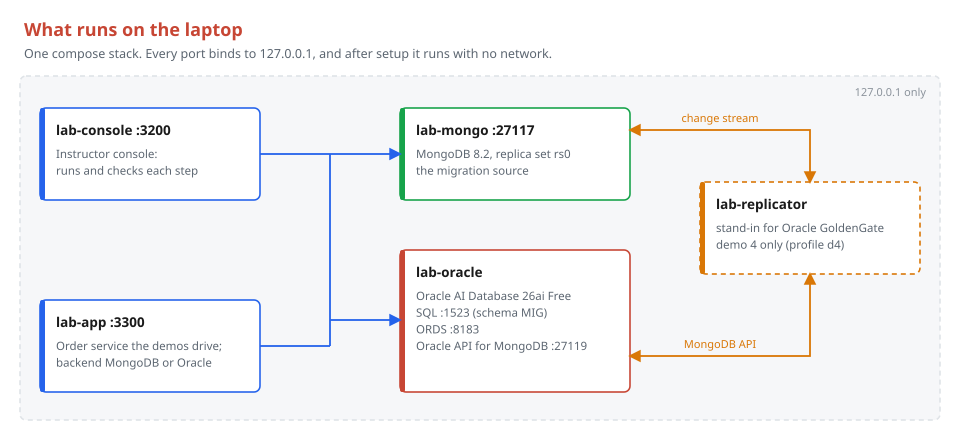
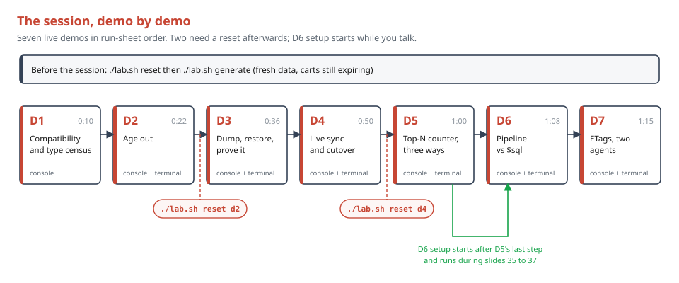
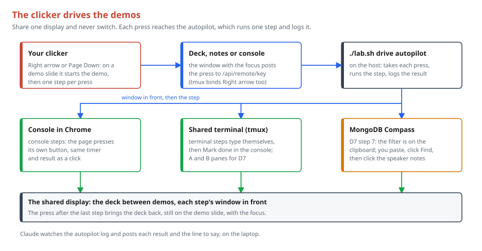
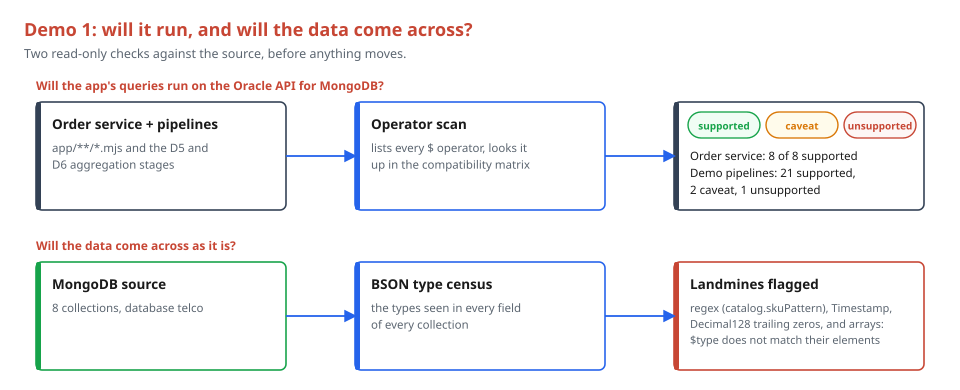
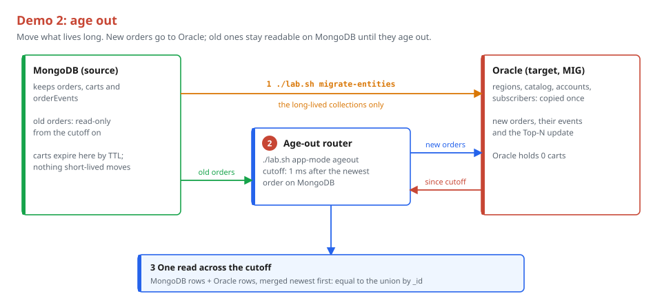
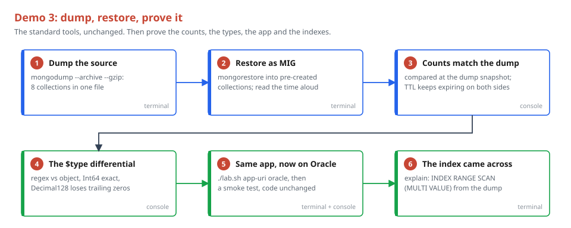
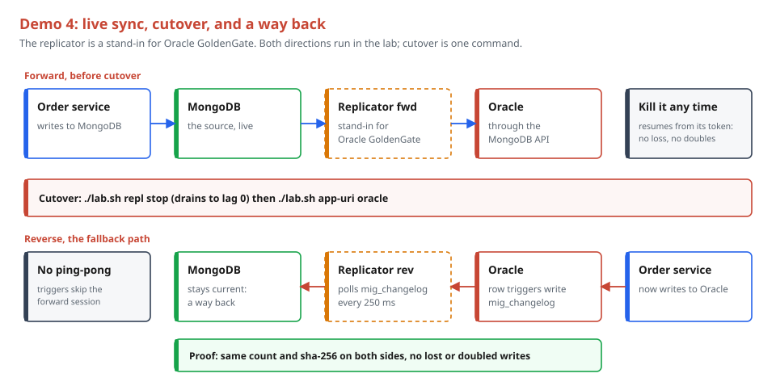
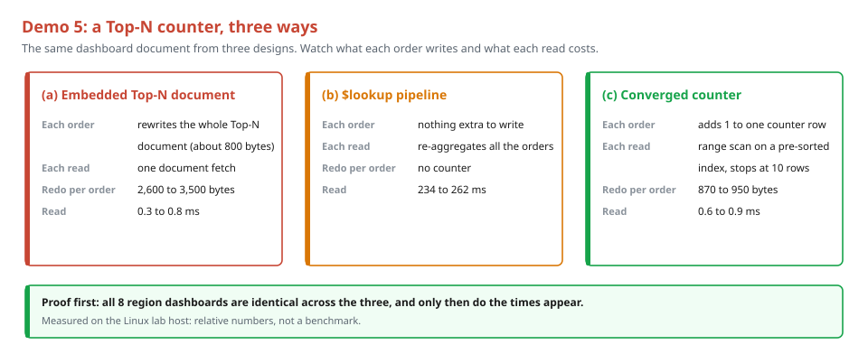
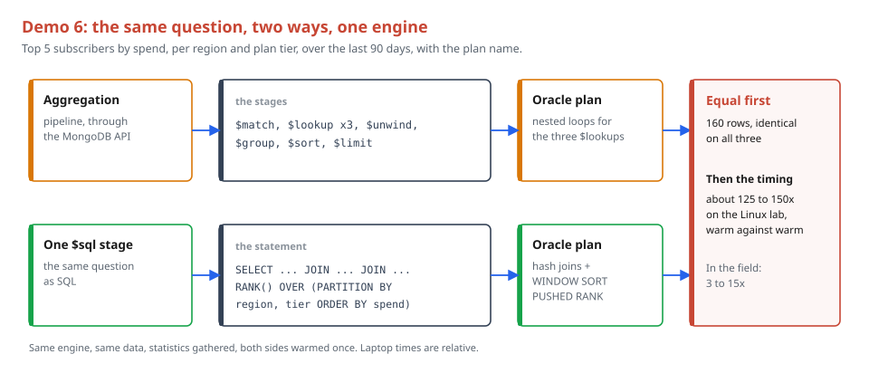
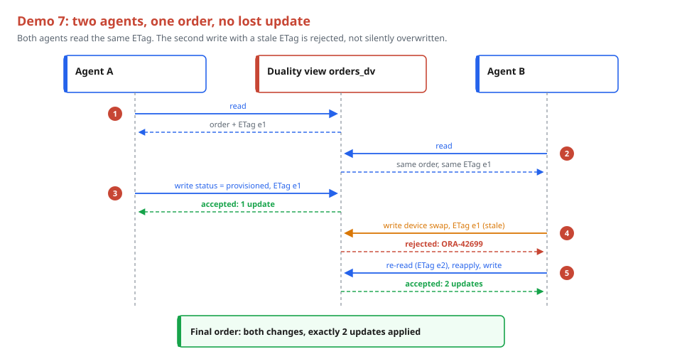

# MongoDB to Oracle Migration Lab

Built on **Oracle AI Database 26ai**.

Lab stack and demos for the MongoDB to Oracle migration deep dive session. One
compose stack runs the migration source (MongoDB) and the target (Oracle AI
Database 26ai Free with ORDS and the Oracle API for MongoDB) on your laptop.
After a one-time setup it runs fully offline.

## What runs



| Service | Container | What it is |
|---|---|---|
| `mongo` | `lab-mongo` | MongoDB 8.2, single-node replica set `rs0` (the source) |
| `oracle` | `lab-oracle` | Oracle AI Database 26ai Free + ORDS + Oracle API for MongoDB (the target) |
| `console` | `lab-console` | Instructor console for the demos (app image) |
| `app` | `lab-app` | Order service the demos drive (its backend is switchable) |
| `replicator` | `lab-replicator` | Stand-in for Oracle GoldenGate, used in demo 4 only (profile `d4`) |

The Oracle app schema is `MIG` (password from `MIG_PASSWORD`; the lab default
is set in `lab.sh` and `lib/config.mjs`). It is created and ORDS-enabled when
the database first boots. Commands that log in as MIG (`./lab.sh mongosh ora`,
`./lab.sh migrate-entities`, `./lab.sh mongorestore-ora`) build the URI from
`MIG_PASSWORD`, so no command, slide or console step shows the password.

MongoDB is 8.2 rather than 8.0 because mongod 8.0 will not start on Linux
kernel 6.19 or newer (MongoDB issue SERVER-121912).

## Ports

Every port binds to `127.0.0.1` only. Nothing is published to the network.

| Host port | Service |
|---|---|
| 27117 | MongoDB source (`mongodb://localhost:27117/telco?replicaSet=rs0&directConnection=true`) |
| 1523 | Oracle SQL (`localhost:1523/FREEPDB1`) |
| 8183 | ORDS and Database Actions (`http://localhost:8183/ords/`) |
| 27119 | Oracle API for MongoDB |
| 3200 | Lab console |
| 3300 | Order service app |

## One-time setup on the Mac (Apple silicon)

1. Install Podman (the installer from podman.io, or `brew install podman`)
   and a compose provider for `podman compose` (`brew install docker-compose`),
   then create a machine big enough for Oracle:

   ```sh
   podman machine init --cpus 6 --memory 16384 --disk-size 60
   podman machine start
   ```

2. With network, fetch and build the images:

   ```sh
   ./lab.sh pull
   ./lab.sh build
   ```

3. Confirm the laptop is ready: `./lab.sh preflight`. It checks the CPU is
   arm64, `podman compose` has a provider, the Podman machine has at least 12 GB of memory, every image is
   present, and nothing else is listening on the lab ports.

The full presenter walk-through, from a new Mac to the session (the run sheet
for every demo, the resets between demos, the offline check and what to
report back), is `docs/REHEARSAL.md`.

That is all a presenter needs: Podman. Node is not required on the laptop.
Demos, resets, the data generator and every terminal command run inside the
lab containers. Node.js 22 or newer (plus `npm install`) is only for
developers who run the test suite (see Tests).

On Linux the same commands work with Docker. `lab.sh` uses `podman compose`
when `podman` is on your PATH (or `PODMAN=1` is set), otherwise `docker compose`.

## Everyday commands



| Command | What it does |
|---|---|
| `./lab.sh pull` | Pull the base images (needs network) |
| `./lab.sh build` | Build the lab images (needs network the first time) |
| `./lab.sh up` | Start the stack in the background |
| `./lab.sh check` | Wait up to 600 s (`CHECK_TIMEOUT`) until MongoDB, Oracle, ORDS and the Oracle API for MongoDB all answer; prints one line per service |
| `./lab.sh preflight` | Laptop readiness checks (see above) |
| `./lab.sh down` | Stop the stack and keep the data |
| `./lab.sh reset` | Wipe the lab data volumes and start fresh |
| `./lab.sh reset dN` | Reset one demo to its starting state |
| `./lab.sh demo dN [--step S]` | Run a demo from the terminal (`--help` for usage) |
| `./lab.sh generate [--scale S]` | Load the deterministic dataset into the MongoDB source (`--scale demo` by default, `--seed N` to change the seed) |
| `./lab.sh mongosh src [args...]` | mongosh against the MongoDB source (`telco`), run inside `lab-mongo` |
| `./lab.sh mongosh ora [args...]` | mongosh against the Oracle API for MongoDB as `MIG`, run inside `lab-oracle` from `/opt/lab`, where the image keeps the demo scripts (`demos/d6-sql/`) |
| `./lab.sh exec <service> <cmd...>` | Run a command inside a lab container, for example `./lab.sh exec mongo mongosh` |
| `./lab.sh app-uri <mongo\|oracle>` | Point the order service at MongoDB or at the Oracle API for MongoDB (switched live, no restart) |
| `./lab.sh app-mode <ageout\|normal>` | Demo 2: put the order service in age-out mode (orders before the cutoff read from MongoDB, new orders on Oracle) or back to MongoDB alone (switched live, no restart) |
| `./lab.sh agent read\|write\|retry --agent A\|B` | One of demo 7's two agents (`--api sql` on `read` to use SQL instead of the MongoDB API) |
| `./lab.sh repl fwd\|rev\|stop\|status\|logs` | Demo 4's stand-in for Oracle GoldenGate: start it forward (MongoDB to Oracle) or reverse (Oracle to MongoDB), stop it (drains to lag 0 first), show its state, follow its log |

`demo`, `reset dN`, `generate` and `agent` run Node in a one-off `runner` container
(`compose run --rm runner`, the app image), never inside `lab-app`, so a demo
step can switch the order service without stopping itself. The runner reaches
the databases over the compose network, so the stack must be up. The app image
also carries the MongoDB Database Tools and mongosh, and the runner mounts the
`dumps` volume (also mounted in `lab-mongo` at `/dumps`) for demo 3 and the
`state` volume at `/state` (demo 7's agents remember what they read there,
between one-off runs). The code
(`lib/`, `gen/`, `oracle/`, `app/`, `demos/`) is baked into the app image, not
mounted, so after changing any of it run `./lab.sh build` and `./lab.sh up` again. Developers can run them with
the host's Node instead by setting `LAB_HOST_NODE=1`.

Example terminal commands:

```sh
./lab.sh mongosh src --eval 'db.orders.countDocuments()'
./lab.sh mongosh ora --eval 'db.getCollectionNames()'
```

The first Oracle boot can take a few minutes. Run `./lab.sh check` after
`./lab.sh up` and wait for four `OK` lines.

## Dataset

`./lab.sh generate --seed 20261114 --scale demo` drops the MongoDB
database `telco` and loads a deterministic telecom dataset: the same seed always
gives the same documents (only `carts.updatedAt` and `orderEvents.createdAt`
follow the load clock). On the
Linux lab it builds and loads in about 7 s.

| Collection | `demo` | `tiny` (unit tests) |
|---|---|---|
| `regions` | 8 | 8 |
| `catalog` (120 devices, 60 plans, 120 add-ons) | 300 | 300 |
| `accounts` (family plans up to 3 levels) | 20,000 | 200 |
| `subscribers` | 30,000 | 300 |
| `orders` | 200,000 | 2,000 |
| `carts` (TTL 120 s on `updatedAt`) | 5,000 | 50 |
| `orderEvents` (TTL 7 days on `createdAt`) | 300,000 | 3,000 |
| `regionTopDevices` (Top 10 devices per region) | 8 | 8 |

Planted BSON types a migration has to carry: `catalog.skuPattern` is a regular
expression, `orders.version` is a 64-bit integer (one order holds
9007199254740993, more than 2^53), `orderEvents.ts` is a BSON Timestamp, and
prices and totals are Decimal128.

Carts get `updatedAt` spread from 2 minutes before the load to 3 hours 58 minutes
after it, so they expire steadily over the first 4 hours (about 21 a minute at
demo scale). Run `./lab.sh generate` no more than 30 minutes before the session:
about half the carts are still there at the end of it, and some expire live
during D2. Each order event gets a
`createdAt` Date between 7 days before the load and the load itself, so the event
log ages out steadily over the next week. The TTL index sits on `createdAt`
because a TTL index only expires Date values; `ts` stays a BSON Timestamp.

## Oracle target prep

Before any data moves, the target collections are created explicitly in SQL,
never by a first write through the MongoDB API (implicit schema creation is a
known ORA-00600 risk once supplemental logging is on).
`oracle/sql/00-target-prep.sql` creates one JSON collection table per source
collection in the `MIG` schema, with quoted names that match the MongoDB
collection names exactly (`"orderEvents"`, `"regionTopDevices"`).
`prepareTarget({ drop })` in `oracle/prep.mjs` runs it (dropping the tables
first when `drop` is true, for an empty target) and confirms `MIG` is
ORDS-enabled through `user_ords_schemas`. It is idempotent and
shared by demos 2, 3 and 4. Indexes are not created here: `mongorestore` carries them.

## Order service app

`app/server.mjs` is a small order service written the way a typical MongoDB
app is written (`find`, `insertOne`, `updateOne` with `$set`, `$inc`, `$push`,
`$sort`, `$slice`). Its only setting is the backend URI, which is what demos 3
and 4 flip. It is built into its own image (`docker/app/Dockerfile`, which runs
`npm ci` inside the image), so the laptop needs only Podman: `./lab.sh build`
builds it and `./lab.sh preflight` checks it is present. Rebuild after changing
the app code. It starts on `APP_MONGO_URI` from `.lab/app.env`.
`./lab.sh app-uri oracle` rewrites that file (so a restart keeps the choice) and
switches the running service through `POST /admin/backend`, with no restart;
the demo runner calls the same endpoint. `./lab.sh demo` and `reset dN` sync the
file to the live backend afterwards.

| Route | What it does |
|---|---|
| `GET /orders/:id` | One order, as canonical Extended JSON (Decimal128 totals, Int64 versions) |
| `POST /orders` | Body `{subscriberId, lines: [{sku, qty}]}`. Writes the order, its `orderEvents` entry, and keeps the region's Top 10 in `regionTopDevices` exact. Returns `{_id}` |
| `PATCH /orders/:id` | Body `{status}` and/or `{deviceSwap: {from, to}}` |
| `GET /subscribers/:id/orders?from=&to=` | One subscriber's orders placed in `[from, to)` (ISO dates, either may be left out), newest first |
| `GET /dashboard/top-devices/:region` | The region's Top 10 devices |
| `GET /health` | `{backend: 'mongodb' or 'oracle', ok}` for the live backend; in age-out mode `{backend: 'ageout', cutoff, legacy, current}` |
| `POST /admin/backend` | Body `{target: 'mongo' or 'oracle'}`, or `{target: 'ageout'}` for demo 2 (answers with the cutoff). Connects and pings the new backend(s), then swaps them in; 503 and no change if one cannot be reached. Port 3300 is bound to 127.0.0.1 only |

`/health` tells the backends apart through `buildInfo`: MongoDB includes a
`gitVersion`, the Oracle API for MongoDB reports only a MongoDB-compatible
version (7.0.22 on 26ai Free) and names itself through `serverStatus.ordsVersion`.

## Instructor console

Open http://127.0.0.1:3200 (the `console` service starts with `./lab.sh up`).
Pick a demo at the top, then work down its steps on the left.

- **Console steps:** press **Run step**. A running step shows a live timer.
- **Terminal steps:** the console shows the command. Press **Copy**, type or
  paste it in a terminal, then press **Mark done**. The console never runs
  commands itself; Mark done only checks that the command worked.
- **Results:** a summary, a strip of numbers, the left and right result panes,
  and plans side by side when a step has them. **Text output** is the same
  text `./lab.sh demo` prints.
- **Timings wait for equal results:** in demo 5 the read times stay hidden
  until "Same document, three ways" passes (Ruling W), and in demo 6 the
  pipeline and `$sql` times stay hidden until "Equal results" passes (Ruling T).
  The console also never shows how long a step took, only a timer while it runs.
- **Not ready:** while Oracle is still starting, steps answer "Oracle is still
  starting (ORDS not ready)". The dots in the header show which service is up
  (checked every 10 s, not while a step runs).
- **Recorded fallback:** every step that passes is saved as the rehearsal
  result in `/state/recorded/<demo>.json` (the `state` volume). **Skip to
  result** shows it, labeled "Recorded at rehearsal" with its time. A full
  `./lab.sh reset` deletes the volume, so after a good rehearsal run
  `./lab.sh bake-recordings` and commit `fallback/recorded/`: with no
  recording in the volume, the console serves that copy (labeled "saved in
  the repo"; rebuild the image after baking). Re-bake after a demo changes.
  `node scripts/record-clips.mjs` (developers, needs Chrome) makes those
  recordings from one clean run: it resets the lab, generates the data, then
  clicks through D1 to D7 in the console in run-sheet order (running each
  terminal step's command itself) and saves a 1280x720 video of each demo
  to `clips/dN.webm` (not committed: the presenter's local fallback). It
  exits 1 if any step failed; bake only a clean run.
- **Reset demo** runs the demo's reset. For demo 4, run `./lab.sh reset d4`
  in the terminal instead: it stops the replicator container first.
- **Theme:** the button at the top right switches light and dark;
  `?theme=dark` in the URL does the same.
- **Let Claude drive:** `./lab.sh drive` lets a Claude Code session run the
  steps for you on the shared screen. It queues console steps through the
  console's remote channel (`/api/remote`); the open page presses its own
  buttons. It types terminal commands into the tmux session `lab`. The
  `drive-demo` skill in `.claude/skills/` is the protocol. Setup and use:
  `docs/REHEARSAL.md` section 7.



The console runs as one long process, so demos keep their state from step to
step. It is baked into the app image: run `./lab.sh build` after changing it.
`node scripts/shots.mjs --run d5` (developers, needs Chrome) clicks through a
demo and saves 1280x720 screenshots in both themes to `docs/shots/`.

## Deck

Open `deck/index.html` straight from disk (file://) in Chrome. It needs no
server and no network: Reveal.js 5.1.0 and the fonts are in the repo.

- **Keys:** arrows or a clicker walk every slide in order; **S** opens the
  speaker view (notes, timer, next slide); **T** switches light and dark.
  `?theme=dark` in the URL picks dark at load.
- **Authoring:** one `<section data-segment="N">` per session segment, slides
  inside it, and an `<aside class="notes">` on every slide. Demo transition
  slides get `class="demo"`.
- **Figures:** each `fig_<name>()` in `deck/build/build_figs.py` writes
  `deck/figures/<name>.svg` and splices the figure into the deck between
  `<!-- FIG:<name> -->` markers. It refuses anything out of frame, colliding
  or with a line through text, and renders light and dark PNGs to check by eye.
- **Animations:** Reveal fragments work on SVG groups (`group(f, "fragment")`,
  the three-doors figure). Reveal auto-animate cannot resize a shape inside an
  SVG (it measures with offsetLeft/offsetWidth), so a shape that must morph
  across slides is drawn with `overlay()`: an HTML box laid over the SVG,
  matched by `data-id` (the age-out router's three states).
  `ov()` adds a solid wire and left or right arrowheads the same way (the
  blue/green figure: the app's wire slides to green, the replication arrow
  turns around). A bar that grows on its click is a `fragment custom bar-grow`
  group (the window math figure). An overlay can sit hidden behind an opaque
  SVG box and slide out on the next slide (the canonical form fanning into
  projections), and `overlay(..., attrs='data-auto-animate-delay="0.7"')`
  starts one move after another (the ETag figure: agent A's write lands, then B's
  bounces and turns red).
- **QA:** `deck/build/qa_deck.py` renders every slide at 1280x720 and fails on
  overflow, overlapping slide rows (`data-qa-allow-overlap` on a layer inside a row opts it out and is counted per slide), an SVG drawn below 0.80 scale, missing or empty notes, an em dash,
  the old version name, more than 45 visible words on a non-demo slide
  (`--word-budget N`), and with `--offline` any request that is not file://.

```sh
python3 deck/build/build_figs.py
python3 -m pytest deck/build
python3 deck/build/qa_deck.py deck/index.html --offline --shots /tmp/shots
python3 deck/build/qa_deck.py deck/index.html --dark --offline --shots /tmp/shots
```

## Tests

Developers only: needs Node.js 22 or newer and `npm install` on the host. The
tests run Node on the host (`LAB_HOST_NODE=1` where they call `lab.sh`).

```sh
npm test                 # unit tests; integration files skip unless LAB_UP=1
LAB_UP=1 npm test        # everything, the full-run test below included (stack up; it wipes the lab)
npm run test:unit
npm run lint:copy        # copy rules: no em dashes, say 26ai, no private references
LAB_UP=1 npx vitest run test/integration/full-run.test.mjs   # the whole session, about 12 minutes
```

The full-run smoke test wipes the lab (`./lab.sh reset`), generates the data,
then runs D1 to D7 headless in session order with the run sheet's resets
between them (`scripts/run-sheet.mjs`, the same list `docs/REHEARSAL.md`
gives the presenter). Every step must pass, twice in a row.

## Demo 1: compatibility check and type census



`./lab.sh demo d1` runs it headless in a few seconds. It reads only: it needs
a generated MongoDB source (`./lab.sh generate`) and nothing else, so
`./lab.sh reset d1` has nothing to undo. Two console steps:

- `scan`: the scripted operator scan (built for this lab). It parses the
  order service (`app/**/*.mjs`) with acorn, lists every `$` operator it uses,
  and sorts them into supported, caveat and unsupported on the Oracle API for
  MongoDB. A second table does the same for the D5 and D6 pipelines. The
  lookup table is `demos/d1-compat/compat-matrix.json`: the oracle-ai-dev
  plugin's reference matrix plus findings measured in this lab, which win.
- `census`: the BSON types per field on the MongoDB source, with the
  landmines marked: regex, Timestamp, Decimal128 scale, and
  arrays (on Oracle, `$type` does not match an array's elements).

There is no advisor step: Oracle's MongoDB Compatibility Advisor does not run
offline in this stack (`docs/spikes/d1-advisor.md`, with the probes behind the
measured entries).

## Demo 2: age out



Strategy A: move only what lives long. `./lab.sh demo d2` runs it headless;
`./lab.sh reset d2` puts back the starting state (order service on MongoDB in
normal mode, the eight MIG collections empty, no order the demo placed left on
the source). It needs a generated source (`./lab.sh generate`, within 30
minutes of the session so carts are still expiring). The presenter's terminal
commands:

```sh
./lab.sh migrate-entities
./lab.sh app-mode ageout
```

`./lab.sh migrate-entities` runs the entity-only dump and restore in the
runner (`demos/d2-ageout/migrate-entities.mjs`). `mongodump` has no
`--nsInclude`, so the dump leaves out what stays (`--excludeCollection` orders,
carts, orderEvents, regionTopDevices) and the restore names what moves
(`--nsInclude` regions, catalog, accounts, subscribers). In age-out mode the order service holds both
backends behind `app/router.mjs`: new orders (and their events and the Top-N
update) go to Oracle; `GET /orders/:id` tries Oracle, then MongoDB; old orders
are read-only; a subscriber's order list is split at the cutoff and merged,
newest first. The cutoff comes from the data, never the clock: 1 ms after the
newest order on MongoDB, kept in `.lab/app.env` (`APP_MODE`, `APP_CUTOFF`) so
a restart keeps it. The dashboard in age-out mode is Oracle's, exact for the
orders placed since the cutoff; an all-time Top 10 cannot be merged from two
Top 10s. Console steps: `new-order` (lands in Oracle, not MongoDB),
`cross-cutoff-read` (MongoDB rows, Oracle rows, the merged read, equal to the
union by `_id`) and `ttl-expiry` (the cart count dropping live; Oracle has no
carts at all).

## Demo 3: dump and restore



`./lab.sh demo d3` runs it headless; `./lab.sh reset d3` puts back the
starting state (order service on MongoDB, the eight MIG collections empty, no
dump). The presenter's terminal commands:

```sh
./lab.sh exec mongo mongodump --archive=/dumps/telco.archive --gzip --db telco
./lab.sh mongorestore-ora --archive=/dumps/telco.archive --gzip --nsFrom 'telco.*' --nsTo 'MIG.*' \
  --numParallelCollections=4
./lab.sh app-uri oracle
./lab.sh mongosh ora --eval 'db.orders.find({region:"R03",status:"provisioned"}).explain()'
```

The restore runs as `MIG` into the pre-created collections ("restoring to
existing collection ... without dropping"). The wrapper's last line is the wall time of the
restore on this laptop, so the presenter reads it off the screen live. Keep the database out of the URI
path: with `.../MIG?...` mongorestore treats it as `--db MIG` and restores 0
documents while still exiting 0. Counts are compared at the dump snapshot
(the archive itself): carts and orderEvents keep expiring on both sides,
because the TTL indexes come across and Oracle runs them too.

## Demo 4: blue/green with a fallback path



`./lab.sh demo d4` runs it headless; `./lab.sh reset d4` stops the
replicator, drops the capture objects, clears `/state/d4` and points the
order service back at MongoDB. Setup does the initial load itself: it notes
the source's operation time, runs D3's dump and restore, then installs the
reverse capture (`oracle/sql/d4-changelog.sql`). The replicator is a stand-in
for Oracle GoldenGate, labeled as one on every log line. The presenter's
terminal commands, in order, with console steps between them:

```sh
./lab.sh repl fwd                                 # MongoDB change stream -> Oracle API for MongoDB
./lab.sh repl stop && ./lab.sh app-uri oracle     # cutover: drain to lag 0, stop, flip the app
./lab.sh repl rev                                 # mig_changelog -> MongoDB, the fallback path
```

- Forward reads the `telco` change stream (`fullDocument: 'updateLookup'`,
  exact BSON types) and writes `replaceOne` (upsert) or `deleteOne` by `_id`
  in batches of 100 changes or 250 ms, saving the resume token after each
  batch in `/state/d4/fwd.token`. Kill it at any point and `./lab.sh repl
  fwd` resumes from the token; a replayed batch is idempotent, so nothing is
  lost or doubled.
- Reverse: one compound trigger per MIG collection writes each changed
  document to `mig_changelog`; the replicator polls it every 250 ms (position
  in `/state/d4/rev.seq`) and makes MongoDB match Oracle for those documents.
- No ping-pong: ORDS sets each session's `CLIENT_INFO` to the MongoDB logical
  session id of the request, so the forward applier sends all its writes in
  one session, registers its id in `mig_repl_session`, and the triggers skip
  it. A `CLIENT_INFO` set by the replicator itself would never reach ORDS.
- `verify` compares counts and sha-256 on both sides in the form the Oracle
  API stores (Decimal128 without trailing zeros, Timestamp and regex as BSON
  types). carts and orderEvents expire on both sides on their own clocks, so
  only their documents not near expiry are compared.
- `./lab.sh repl status` shows each direction's changes applied and lag.

## Demo 5: Top-N real-time counter



`./lab.sh demo d5` runs it headless; `./lab.sh reset d5` puts back the
starting state. D5 runs on Oracle after D3: if `MIG.orders` is empty, setup
runs D3's dump and restore first. Setup then builds the converged tables
(`oracle/sql/d5-converged.sql`: `region`, `device`, `device_sales`, the
`device_sales_topn` index, the duality view `region_top_devices_dv` and the
read-only JSON view `region_top_devices_v`) from the restored orders, and
resets `regionTopDevices` to the same Top 10, so all three variants start
from the same truth. Each write step removes the previous D5 orders, places
the same 200 seeded orders through its variant and measures redo per order
(instance-wide `v$sysstat`, median of batches; laptop numbers are relative).
The presenter's terminal command:

```sh
./lab.sh mongosh ora --eval 'db.region_top_devices_v.findOne({_id:"R03"})'
```

26ai Free cannot order or limit a nested array inside a duality view, so the
Top 10 document comes from `region_top_devices_v`, and the duality view
carries the full device list and the write path. Details, errors and the
measured numbers: `docs/spikes/d5-duality-nested-order.md`.

## Demo 6: Pipeline vs `$sql`



`./lab.sh demo d6` runs it headless; `./lab.sh reset d6` puts back the
starting state, and always re-runs D3's dump and restore to do it (about a
minute). The question: top 5 subscribers by spend per region and plan
tier, over the last 90 days of the data (`2026-07-03` to `2026-10-01`, fixed
by the generator, never the wall clock), with plan name. D6 runs on Oracle
after D3: if `MIG` does not hold the source's orders for that window, setup
runs D3's dump and restore first, then gathers optimizer statistics on
`orders`, `subscribers`, `accounts` and `catalog` (a bulk load leaves none).
The same pipeline (`demos/d6-sql/queries.mjs`) runs on MongoDB for its
explain only, then on Oracle through the MongoDB API (timed); the same
question as SQL (`demos/d6-sql/top-spenders.sql`) runs as one `$sql` stage
(timed). Results are proven equal before any time is shown; no MongoDB
timing is taken. The presenter's terminal command (the script is baked into
the oracle image under `/opt/lab`; rebuild with `./lab.sh build` after
editing it):

```sh
./lab.sh mongosh ora demos/d6-sql/sql-stage.js
```

The pipeline through the API takes over a minute per run on a laptop, so
live (the console) it is timed once while the presenter talks through the
plan; `./lab.sh demo d6` and the tests time it over 3 runs (compose passes
`D6_PIPELINE_RUNS=3` to the runner; `D6_PIPELINE_RUNS=1 ./lab.sh demo d6` for
a quick rehearsal). `$sql` is timed over 7 runs. Setup (and `reset d6`) first runs each side once, untimed, so the timed runs compare warm with warm: the first pipeline run after a restore is cold, about 135 s, against 80 to 90 s warm.
Plans, medians and the ratio: `docs/spikes/d6-ratio.md`.

## Demo 7: ETags, two agents, no lost update



`./lab.sh demo d7` runs it headless; `./lab.sh reset d7` puts back the
starting state. D7 runs on Oracle after D3: if `MIG.orders` is empty, setup
runs D3's dump and restore first. Setup then builds `order_hdr` (status) and
`order_line` (sku, qty) from the region R03 orders, a change log filled by row
triggers, and the duality view `orders_dv` (`oracle/sql/d7-orders-dv.sql`),
picks the demo order and clears both agents' memory. Two terminals, one per
agent, in this order:

```sh
./lab.sh agent read --agent A     # terminal 1
./lab.sh agent read --agent B     # terminal 2
./lab.sh agent write --agent A    # terminal 1: status -> provisioned, accepted
./lab.sh agent write --agent B    # terminal 2: device swap with a stale ETag, rejected (ORA-42699)
./lab.sh agent retry --agent B    # terminal 2: re-read, reapply, accepted
./lab.sh demo d7 --step final     # both changes, exactly 2 updates applied
```

Each agent keeps the document and ETag it last read in
`/state/d7/agent-A.json` (or `-B`) on the `state` volume (`.lab/state/d7/` with
`LAB_HOST_NODE=1`). The agents use the MongoDB API, which enforces the ETag; a
write that leaves `_metadata` out is last writer wins. Details and the exact
errors: `docs/spikes/d7-etag-mongo-api.md`.

## License

Universal Permissive License (UPL) 1.0, see [LICENSE](LICENSE). Copyright (c) 2026
Oracle and/or its affiliates.
